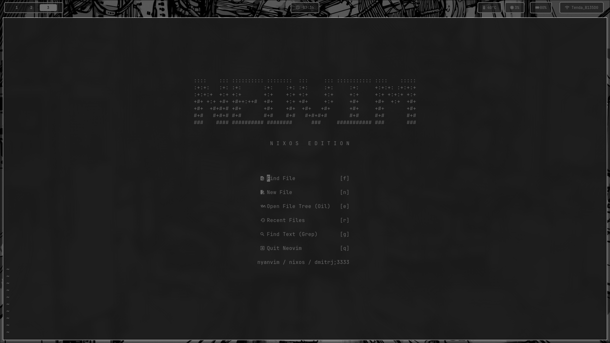
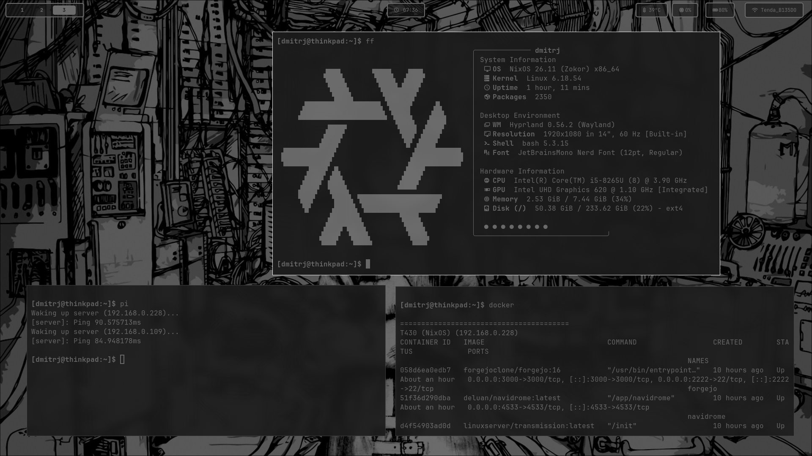

# NixOS-Hyprland-dots
i just love hyprland and nixos


this:


Or so:



OR:



# install
```bash
git clone https://github.com/Dymon1403/NixOS-Hyprland-dots.git
cd NixOS-Hyprland-dots/
```
Replace configuration.nix and rename the variables within it for example, `networking.hostName` and `users.users.`
you need rename username in `configuration.nix`, `home.nix`, `flake.nix`

```bash
git init
git add .

```
# NOTE
CP YOUR hardware-configuration.nix IN DOTS DIR

```bash
sudo cp /etc/nixos/hardware-configuration.nix ~/NixOS-Hyprland-dots/

```
next:

```bash
sudo nixos-rebuild switch --flake .#YOUR NETWORK NAME IN configuration.nix

```
akdaspdodjapsf

move hyprland.lua ro your PATH(.config/hypr/hyprland.lua)

```bash
cp hypr/hyprland.lua ../.config/hypr/hyprland.lua

```

```bash
mv NixOS-Hyprland-dots/  anus/

```
great, That`s all
